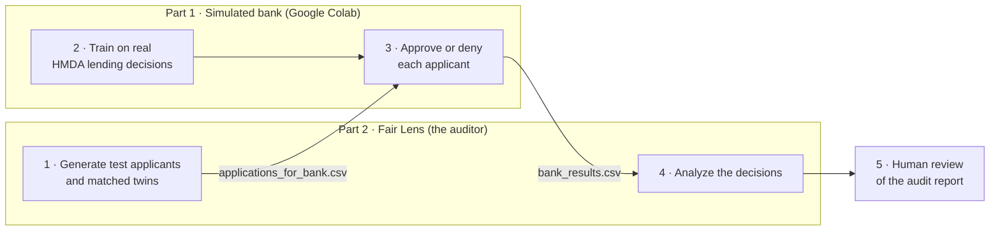

# Fair Lens

**An automated auditor that catches hidden bias in AI loan models before it reaches customers.**

Built at **Sparthill Hacks 2026** for the IBM *Responsible AI for Business & Society* track by IBM Group 27.

---

## Why we built it 

AI now helps decide who gets a loan, a job, or a home, yet businesses have no independent way to prove those decisions are fair.

Removing race from a model's inputs doesn't remove bias. A model can still learn it from where an applicant lives. Lending discrimination by neighborhood, called redlining, is still happening: in 2023, City National Bank agreed to pay over $31 million to settle Justice Department allegations of redlining in Los Angeles ([DOJ press release](https://www.justice.gov/archives/opa/pr/justice-department-secures-over-31-million-city-national-bank-address-lending-discrimination)). It was the largest redlining settlement in the department's history.

Fair Lens treats a bank's loan model as a **black box**. It sends the model realistic test applicants, collects its approve/deny decisions, and checks whether any group is treated unfairly. It never needs to see the model's code.

## How it works

The project has two parts. They connect only through two CSV files, the same way an outside auditor would work with a real bank.



1. **Generate.** Fair Lens builds about 2,100 test applicants from real 2018 Los Angeles County mortgage data (HMDA). Most come in *matched groups*: twins that are identical except for one factor, like neighborhood, race, ethnicity, sex, or age.
2. **Train.** Part 1 stands in for a bank's loan AI. It's a random forest trained on real HMDA lending decisions.
3. **Decide.** The bank model approves or denies each applicant. It only ever sees financial and neighborhood fields, never demographics.
4. **Analyze.** Fair Lens matches the decisions back to the demographics it kept to itself, then runs the fairness checks below.
5. **Review.** A person reads the audit report and verifies the findings before anyone acts on them.

Demographics stay in `audit_key.csv`, which never leaves the auditor. The bank only ever receives `applications_for_bank.csv`.

## What the audit checks

| Check | Question it answers | Method |
|---|---|---|
| Group fairness | Are some groups approved less often? | Approval rate per group, flagged by the four-fifths rule (ratio below 0.80) |
| Matched-twin swap test | Does changing one factor change the outcome? | Decision flips across matched twins, plus a paired t-test on approval probability (p < 0.01) |
| Consistency | Do identical applications get identical answers? | Twins whose bank inputs are exactly the same must get the same decision |
| Proxy detection | Is any input quietly standing in for race? | Decision tree with 5-fold cross-validated ROC AUC, flagged above 0.65 |
| Historical comparison | How does the model compare to real lenders? | Approval rates by neighborhood against real HMDA decisions (`--with-hmda`) |

Each factor (neighborhood, race, ethnicity, sex, age) gets a severity of none, low, medium, or high. The audit then gives an overall verdict: **fair**, **needs review**, or **unfair**.

### Example result

We planted a small bias in the bank model: a 5-point drop in approval probability for applicants in neighborhoods that are more than 70% minority. Across about 2,100 test applicants, Fair Lens flagged **neighborhood** as **high** severity and returned an overall verdict of **unfair**.

## Repository layout

```
FairLens/
├── FairLens/
│   ├── part1-bank-model/              ← the simulated bank (Part 1)
│   │   ├── Fair_Lens_Part1_Bank_Model.ipynb   ← open this in Google Colab
│   │   └── bank_model.py                      ← same code, also runs from a terminal
│   └── part2-auditor/                 ← Fair Lens itself (Part 2)
│       ├── main.py                    ← command-line entry point
│       ├── config.yaml                ← paths, sample sizes, fairness thresholds
│       ├── requirements.txt
│       ├── data/                      ← HMDA data, generated applicants, bank results
│       ├── src/
│       │   ├── data_prep.py           ← loads and filters HMDA data
│       │   ├── generator.py           ← builds test applicants and matched twins
│       │   ├── ingest.py              ← validates and matches the bank's decisions
│       │   ├── audit.py               ← the fairness checks
│       │   ├── report.py              ← writes the audit report
│       │   ├── bank_connector.py      ← local scoring shortcut for testing
│       │   ├── fake_bank_model.py     ← test-only stand-in model
│       │   └── utils.py
│       ├── tests/                     ← unit tests
│       └── output/                    ← reports land here
└── outdated/                          ← earlier versions, kept for reference
```

## Getting started

You'll need Python 3.10 or newer.

### 1. Install the auditor

```bash
cd FairLens/part2-auditor
python -m pip install -r requirements.txt
```

### 2. Generate test applicants

```bash
python main.py generate
```

This writes two files to `data/`:

- `applications_for_bank.csv`: send this to the bank model
- `audit_key.csv`: keep this; it holds the demographics the auditor needs

### 3. Have the bank score them (Part 1)

**In Google Colab (easiest)**

1. Upload `FairLens/part1-bank-model/Fair_Lens_Part1_Bank_Model.ipynb` to Colab.
2. Run the cells in order. When asked, add your HMDA file(s) and `applications_for_bank.csv`.
3. In the app that opens, click **Train model**, choose the applications file, and click **Approve / deny applicants**.
4. Download `bank_results.csv`.

The **Demo bias** slider adds a deliberate neighborhood penalty, so you can watch Fair Lens catch it.

**From a terminal**

```bash
cd FairLens/part1-bank-model
python -m pip install pandas numpy scikit-learn joblib
python bank_model.py train --hmda path/to/hmda.csv
python bank_model.py score --applications ../part2-auditor/data/applications_for_bank.csv
```

Add `--penalty 0.05` to the score command to plant a 5-point neighborhood penalty.

For training data, download 2018 Los Angeles County records for all lenders from the [HMDA Data Browser](https://ffiec.cfpb.gov/data-browser/data/). A single lender has too few denials to learn from.

### 4. Run the audit

```bash
cd FairLens/part2-auditor
python main.py audit
```

Fair Lens automatically finds the newest `bank_results*.csv` in `data/` or your Downloads folder whose case IDs match the latest batch of applicants. To point it at a specific file, use `--results path/to/bank_results.csv`. To include the historical comparison, add `--with-hmda`.

The audit writes:

- `output/report.html` and `output/report.md`: the readable audit report
- `output/audit_results.json`: every number, for dashboards or other tools
- `output/runs/<date_time>/`: a dated copy of each run, plus the exact bank results it used

**Shortcut for testing on one computer:** `python main.py run-all` runs generate → score → audit in one go. It uses `models/bank_model.joblib` if you've copied Part 1's model there. Otherwise it falls back to a test-only fake model, which is never used for real results.

## AI-written report (optional)

The report can be written by **IBM Granite** on watsonx.ai. Set these environment variables before running the audit:

```bash
export WATSONX_API_KEY="your-api-key"
export WATSONX_PROJECT_ID="your-project-id"
export WATSONX_URL="https://us-south.ml.cloud.ibm.com"
```

Without them, Fair Lens writes the same report from a built-in template, so the audit always works offline.

## Configuration

All settings live in `FairLens/part2-auditor/config.yaml`. The ones you're most likely to change:

| Setting | What it controls | Default |
|---|---|---|
| `hmda_path` | HMDA file used to build test applicants | `data/hmda_real.csv.csv` |
| `results_path` | Bank results to audit (`latest` = auto-pick) | `latest` |
| `n_population` | Realistic applicants for group fairness | 600 |
| `n_matched_pairs` | Matched groups for swap tests | 250 |
| `high_minority_threshold` | Tract minority % that counts as "high" | 70 |
| `fairness.disparate_impact_threshold` | Four-fifths rule cutoff | 0.80 |
| `fairness.proxy_auc_flag_threshold` | When an input counts as a stand-in for race | 0.65 |

## Running the tests

```bash
cd FairLens/part2-auditor
python -m pytest tests/ -v
```

## Limitations

- Part 1 is a **simulated** bank trained on public data, not a real lender's model.
- Matched twins are built from HMDA records, so some combinations (for example, race swaps in certain neighborhoods) have fewer pairs than others.
- Fair Lens flags patterns worth investigating. It is not a legal finding or a compliance certification, which is why every report goes to a human reviewer.

## Built with

Python · pandas · NumPy · scikit-learn · SciPy · Google Colab · IBM watsonx.ai (Granite) · IBM Bob

We used **IBM Bob** to plan the architecture, write and debug code, and test throughout the build.

## Team

**IBM Group 27:** Andrew, Son, Rahul, Zooni, and Sriniketh
